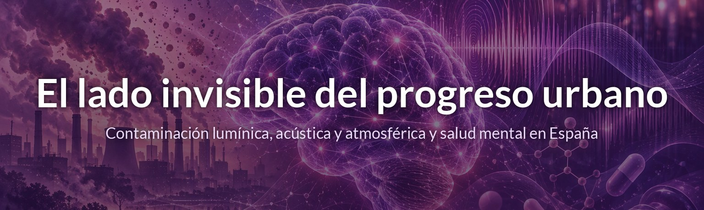
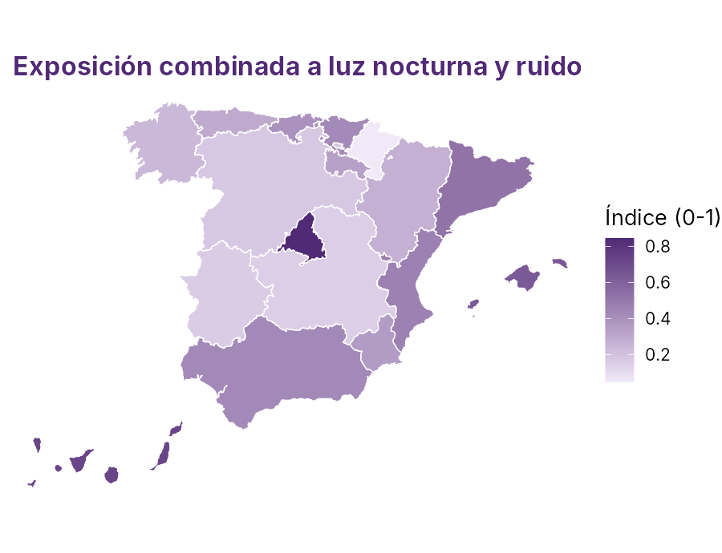
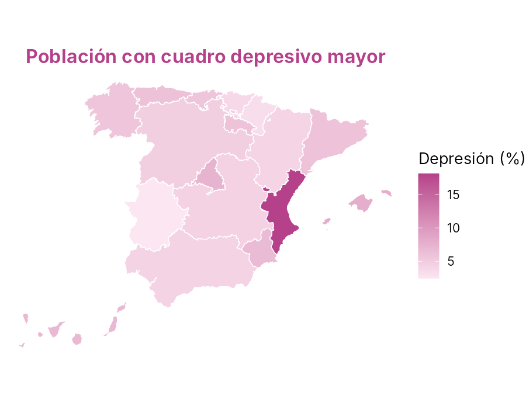
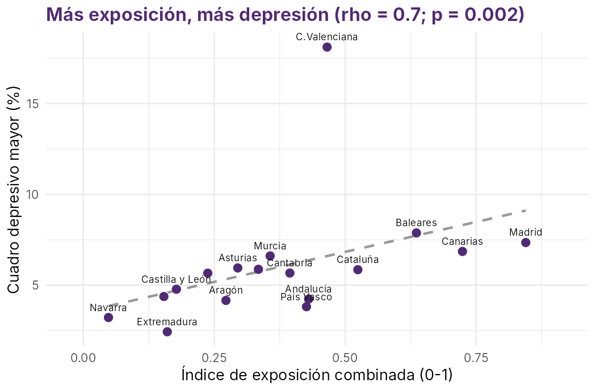
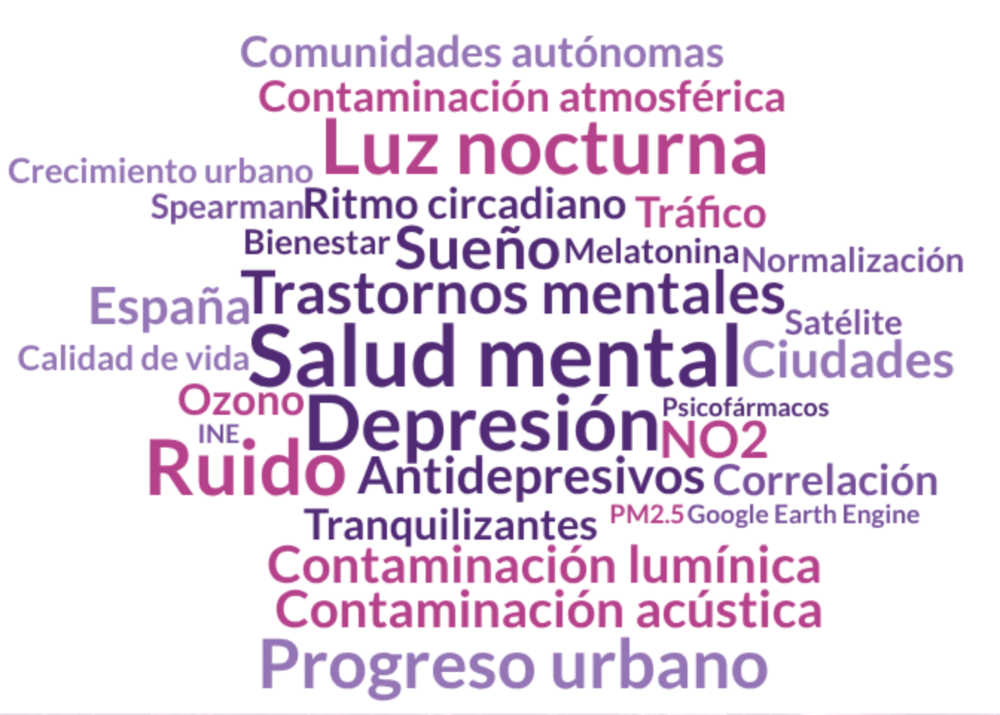

<p align="center">
  
</p>

<p align="center">
  
  
  
  
  
</p>

<div align="center">

# El lado invisible del progreso urbano

**Análisis territorial de la contaminación atmosférica, la exposición a luz nocturna y los indicadores de salud mental en España.**

Seminario de la asignatura **Fuentes de Datos Biomédicos y Web Semántica**
Curso **2026-2027**

**Autoras:** Claudia Fernández Ruiz y Nieves García Morquillas

</div>

---

<div align="center">

## DE QUÉ TRATA

Las ciudades se diseñan pensando en la salud física *(calidad del aire, del agua, radiación...)*, pero ¿qué ocurre con la **salud mental**?

En este seminario se explora, con **datos oficiales** y a escala de **comunidad autónoma**, si la **luz nocturna**, el **ruido** y la **contaminación atmosférica** *(NO2 y O3)* se relacionan con los **trastornos mentales**, la **depresión**, las **horas de sueño** y el **consumo de psicofármacos** en España.

</div>

<div align="center">

## VER EL SEMINARIO

Descarga el archivo **[`Seminario-Fuentes-de-Datos.html`](Seminario-Fuentes-de-Datos.html)** y ábrelo con cualquier navegador.

Contiene el texto, el código en R y todas las tablas, gráficos y mapas interactivos.

</div>

<div align="center">

## PREGUNTAS DE INVESTIGACIÓN

**1.** ¿Una mayor **contaminación lumínica** se vincula con menos **horas de sueño** y más consumo de **fármacos para dormir**?

**2.** ¿La exposición simultánea a **ruido y luz nocturna** se correlaciona con una peor **salud mental**?

**3.** ¿La **molestia por ruido** que percibe la población coincide con el **NO2** (tráfico) y se relaciona con la **depresión** y el consumo de **antidepresivos**?

</div>

<div align="center">

## RESULTADOS EN UN VISTAZO




| Pregunta | Relación estudiada | rho de Spearman | p-valor | Resultado |
|:--:|:--:|:--:|:--:|:--:|
| 1 | Luz nocturna – Horas de sueño | -0,04 | 0,881 | Sin relación |
| 1 | Luz nocturna – Tranquilizantes | 0,12 | 0,649 | Sin relación |
| 2 | Exposición combinada – Depresión | **0,70** | **0,002** | **Asociación fuerte y significativa** |
| 2 | Exposición combinada – Trastornos mentales | 0,39 | 0,117 | Moderada, no significativa |
| 3 | Ruido molesto – NO2 | 0,16 | 0,541 | No coinciden |
| 3 | Ruido molesto – Depresión | **0,62** | **0,008** | **Asociación fuerte y significativa** |
| 3 | Ruido molesto – Antidepresivos | 0,49 | 0,057 | Moderada, casi significativa |



**Importante:** son asociaciones a nivel de comunidad autónoma *(estudio ecológico con 17 comunidades)*, no relaciones causa-efecto.
Las limitaciones se detallan en el apartado de conclusiones del seminario.

</div>

<div align="center">

## EL SEMINARIO EN UNA IMAGEN



</div>

<div align="center">

## FUENTES DE DATOS

| Variable | Año | Fuente |
|:--:|:--:|:--:|
| Luz nocturna, NO2 y O3 | 2023 | [Google Earth Engine](https://earthengine.google.com/) |
| Ruido exterior molesto y trastornos mentales | 2023 | [INCLASNS – Ministerio de Sanidad](https://inclasns.sanidad.gob.es/main.html) |
| Cuadro depresivo mayor | 2022 | [Instituto Nacional de Estadística](https://www.ine.es/) |
| Horas de sueño | 2011 | [Instituto Nacional de Estadística](https://www.ine.es/) |
| Consumo de tranquilizantes y antidepresivos | 2001 | [Ministerio de Sanidad – Encuesta Nacional de Salud](https://www.sanidad.gob.es/estadEstudios/sanidadDatos/home.htm) |
| Población por comunidad autónoma | 2022 | [INE – Padrón a 1 de enero de 2022](https://www.boe.es/eli/es/rd/2022/12/20/1037) |

</div>

<div align="center">

## ESTRUCTURA DEL REPOSITORIO

</div>

```
Seminario-Fuentes-de-Datos/
├── README.md                          <- Esta página
├── Seminario-Fuentes-de-Datos.Rmd     <- Cuaderno de R (texto + código)
├── Seminario-Fuentes-de-Datos.html    <- Seminario renderizado
├── Seminario-Fuentes-de-Datos.Rproj   <- Proyecto de RStudio
├── data/
│   ├── ambientales/                   <- GeoJSON de luz nocturna, NO2 y O3 (2023)
│   └── sanitarios/                    <- Excel y CSV de salud mental, sueño y fármacos
├── bibliografia/
│   ├── referencias.bib                <- Referencias 
│   └── apa.csl                        <- Estilo de citas APA
├── estilos/
│   ├── estilos.css                    <- Diseño del HTML
│   └── fondo_seminario.png            <- Imagen de fondo del HTML
└── img/                               <- Imágenes de este README
```

<div align="center">

## CÓMO REPRODUCIRLO

**1.** Clona el repositorio y abre `Seminario-Fuentes-de-Datos.Rproj` en RStudio.

**2.** Instala los paquetes necesarios (solo la primera vez):

</div>

```r
install.packages(c("sf", "dplyr", "readr", "readxl", "knitr", "kableExtra",
                   "leaflet", "ggplot2", "wordcloud2", "rmarkdown"))
```

<div align="center">

**3.** Abre `Seminario-Fuentes-de-Datos.Rmd` y pulsa **Knit**. Se generan el HTML y las figuras de la carpeta `img/`.

</div>

<div align="center">

## ORIGEN DE LAS IMÁGENES

| Imagen | Origen |
|:--:|:--:|
| `img/banner.jpg` | Recorte de la imagen de fondo del seminario *(generada por las autoras con Microsoft Copilot)* con el título superpuesto |
| `img/mapa_exposicion.png`<br>`img/mapa_depresion.png`<br>`img/dispersion_depresion.png` | Elaboración propia con `ggplot2` a partir de los datos del seminario *(bloque `figuras-readme` del Rmd)* |
| `img/nube_palabras.png` | Captura de la nube de palabras creada con `wordcloud2` en el Rmd |
| Insignias de la parte superior | [shields.io](https://shields.io/) |
| Estilo de citas `apa.csl` | [Citation Style Language](https://github.com/citation-style-language/styles) *(licencia CC BY-SA 3.0)* |

</div>

<div align="center">

## USO DE INTELIGENCIA ARTIFICIAL

En el seminario se declara el uso de **Microsoft Copilot** *(imagen de fondo)* y **ChatGPT** *(apoyo con el CSS)*.

Todo el contenido ha sido revisado por las autoras.

</div>
